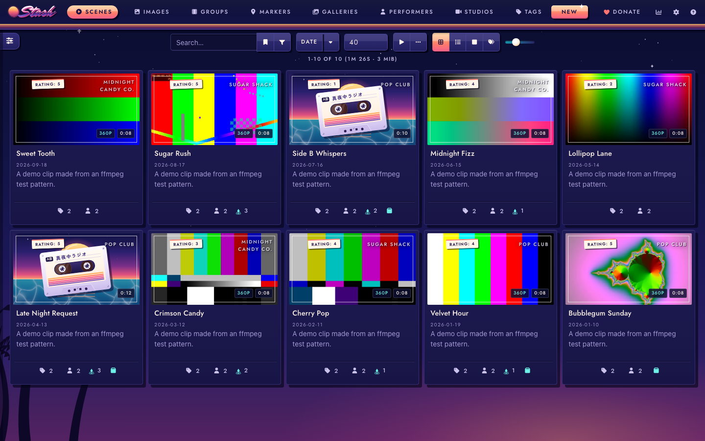
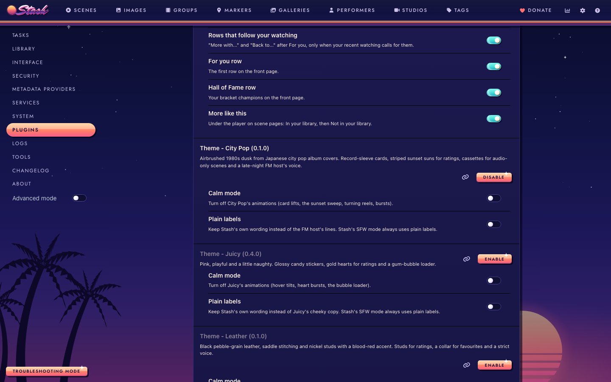
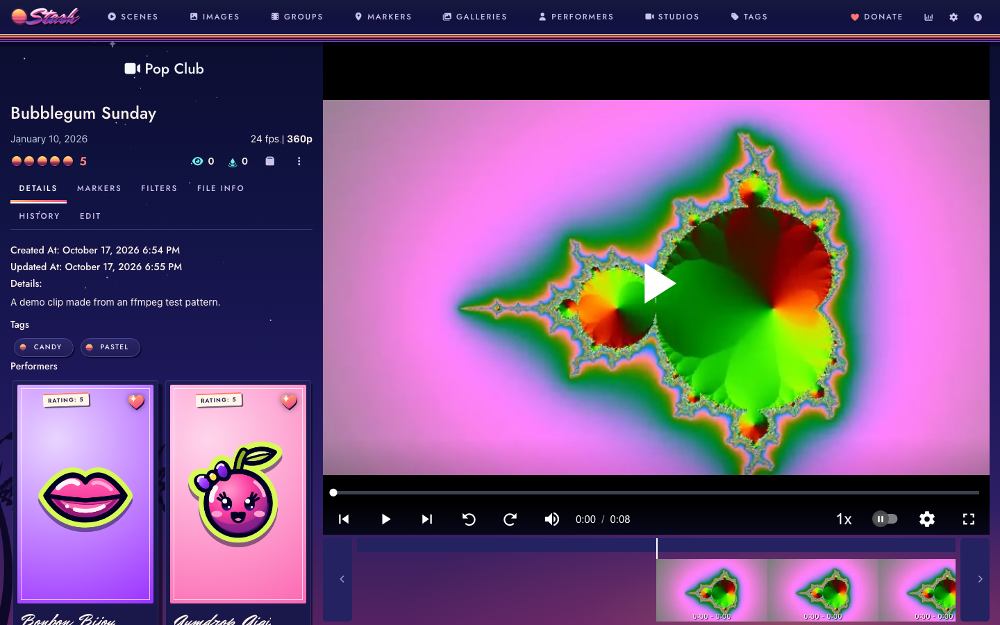
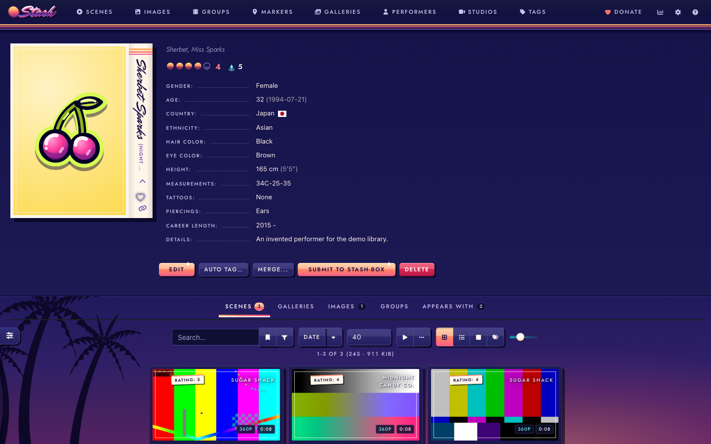
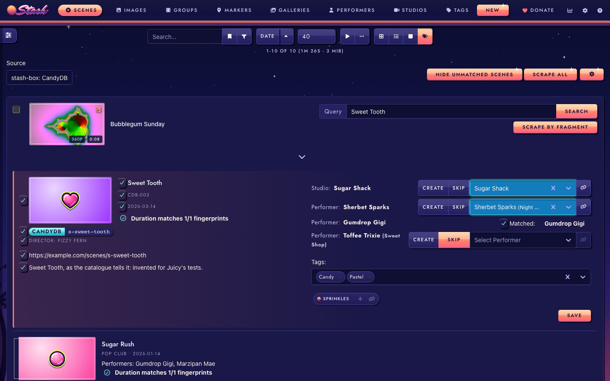
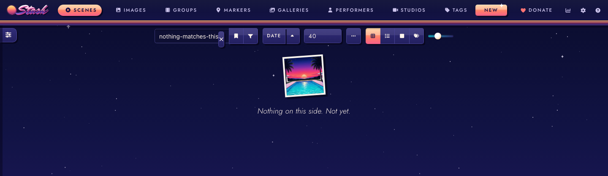
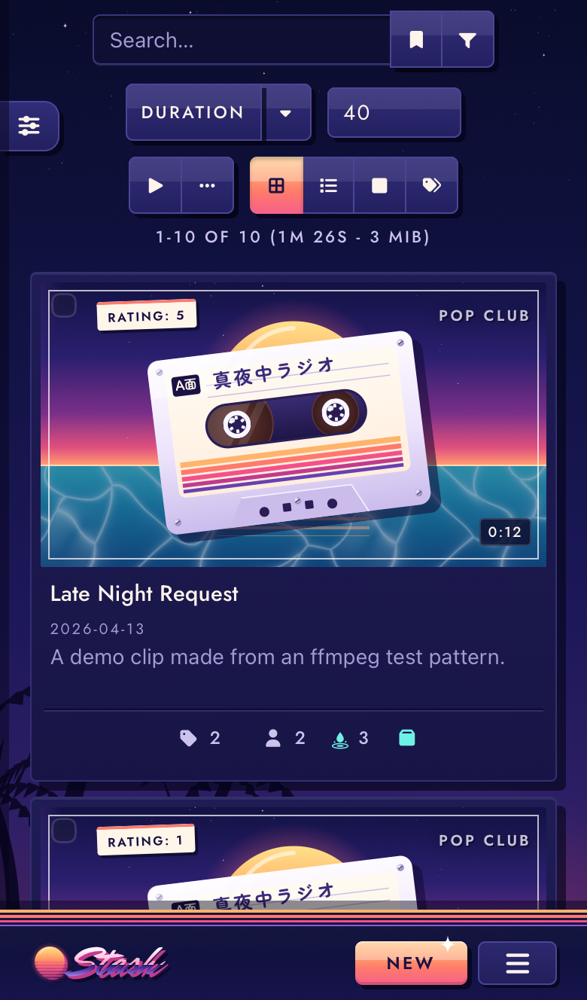

# City Pop

An airbrushed 1980s dusk theme for [Stash](https://github.com/stashapp/stash), the self-hosted media organizer, after the album covers of Japanese city pop. City Pop installs as a Stash plugin, so you switch it on, off or update it from Settings > Plugins instead of pasting CSS into the Custom CSS box.

City Pop sets Stash under a night-blue sky graded into violet, with palm silhouettes, stars and a striped sunset sun that stays down whenever a list or a detail page covers the horizon. Panels are deep navy, the accents are sunset coral and pool turquoise, and buttons are glossy enamel on a hard airbrush shadow. Cards are record sleeves, ratings are striped suns, the favourite is a glossy heart and the O counter is a drop falling into a pool. An audio-only scene gets a cassette on a pool at dusk, a performer's page opens like the J-card of a cassette case, and a short list of Stash's messages speaks as a late-night FM host. Calm mode and Plain labels settings turn the motion and the copy down, and Stash's SFW mode keeps the dusk and drops the voice. The [live preview](https://candyboudoir.github.io/citypop/) shows every component on Stash's own markup, and the design rules are in [docs/design.md](docs/design.md). City Pop 0.1.0 is built and tested on Stash v0.31.1, including the Tagger and scrape screens that a stash-box such as StashDB adds.

## Install

City Pop comes from the CandyBoudoir plugin source, which carries every CandyBoudoir plugin.

1. In Stash, open Settings > Plugins > Available Plugins and click Add source.
2. Fill in the source:
   - Name: `CandyBoudoir`
   - Source URL: `https://candyboudoir.github.io/index.yml`
   - Local path: `candyboudoir`
3. Expand the CandyBoudoir source, tick Theme - City Pop and click Install.
4. Turn off any other theme plugin, and clear any Custom CSS that restyles Stash, then refresh the page.

If you run a Stash develop build, use `https://candyboudoir.github.io/develop/index.yml` as the source URL instead. It carries fixes for upcoming Stash changes before they reach the stable channel, and plugins that have no stable release yet. Add one of the two sources, never both: they carry the same plugins.

Stash lists new versions under Settings > Plugins > Installed Plugins when you click Check for updates. To remove City Pop, select it there and click Uninstall; Stash's own look returns on the next refresh.

## Settings

City Pop's settings sit with the plugin under Settings > Plugins. Both start off.

| Setting      | Effect                                                                    |
| ------------ | ------------------------------------------------------------------------- |
| Calm mode    | Turns off card lifts, the sunset sweep, the turning reels and the bursts. |
| Plain labels | Keeps Stash's own wording instead of the FM host's lines.                 |

City Pop also follows your system's reduced-motion setting. In Stash's SFW content mode City Pop keeps the dusk, the suns and the cassettes, drops the FM host's lines and the pool drops from the bursts, and draws the O counter as a cocktail.

To find audio-only scenes, City Pop asks your Stash once for each new batch of scene cards on screen which of them have no video stream and no cover of their own, and keeps the answers until you reload the page. It makes no other requests and none beyond your own Stash server. Its fonts, Mr Dafoe, Jost and a subset of Zen Maru Gothic holding only the 16 Japanese characters the theme draws, ship inside the plugin. The plugin is about 320 KB.

## Screenshots

| Scene                                                       | A performer                                                             |
| ----------------------------------------------------------- | ----------------------------------------------------------------------- |
|  |  |
| **The Tagger**                                              | **An empty list**                                                       |
|             |         |

The demo library uses invented names and clips made from ffmpeg test patterns, with candy stickers for performer pictures. Two of its scenes are audio-only files.

## Made with AI

City Pop was built with Claude, Anthropic's AI coding assistant, which wrote most of the CSS, JavaScript and SVG motifs under the author's direction. The motifs, glyphs and the caustic tile come from `tools/icons.py`. The poolside at dusk and the pin-up on the design-system page were rendered locally with Qwen-Image 2512 (Apache 2.0) and cropped. The author set the design and reviews the changes before each release. Commits that Claude helped write carry a `Co-Authored-By: Claude` line.

## Development

The repo's [README](../../README.md) covers building, testing and releasing. City Pop's files:

- `src/Theme-CityPop.yml` is the plugin manifest.
- `src/css/` holds numbered partials that the build joins into one `citypop.css`.
- `src/js/citypop.js` adds the FM host's lines, the bursts, the settings and the cassettes on audio-only scenes.
- `src/icons/` holds the glyph masks, the sun, palms, stars, the cassette parts, the caustic tile and the empty pool.
- `src/fonts/zen-maru-gothic/` holds the Zen Maru Gothic subset and its license.
- `design-system/` is the design-system page, published at `/citypop/`. It loads the built theme over Bootstrap 4.6, which stands in for Stash's own styles, and keeps the motifs and illustrations the plugin does not ship.
- `tools/icons.py` draws every motif, glyph and the caustic tile; `tools/zen-maru.sh` makes the font subset.
- `tests/` holds City Pop's compatibility checks and screenshot baselines.
- `plugin.mjs` tells the shared build what goes into the plugin folder.

## License

MIT, in the repo's [LICENSE](../../LICENSE). Mr Dafoe, Jost and Zen Maru Gothic are bundled under the SIL Open Font License 1.1 (`assets/fonts/mr-dafoe/OFL.txt`, `assets/fonts/jost/OFL.txt` and `assets/fonts/zen-maru-gothic/OFL.txt` in the plugin).
