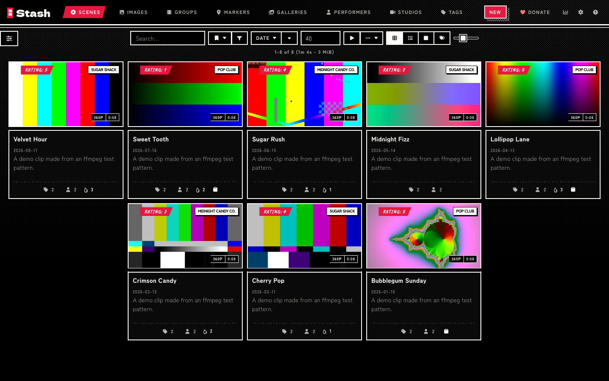
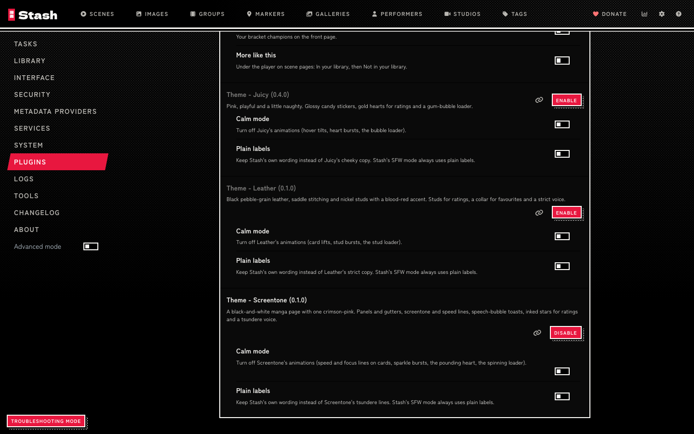
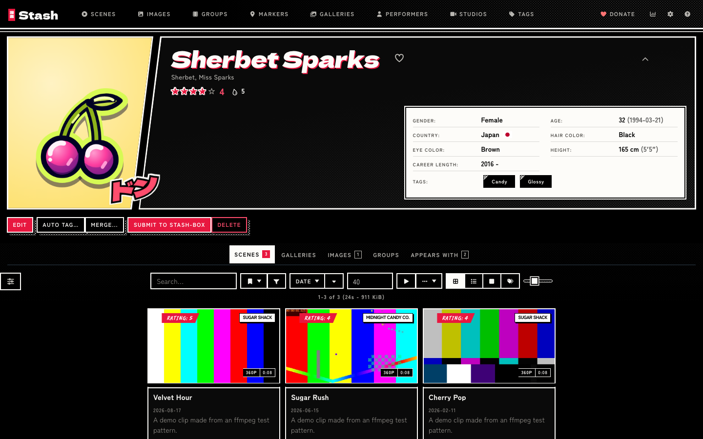
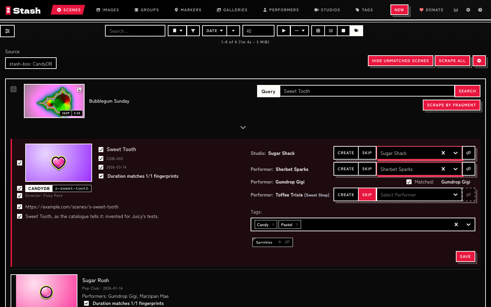
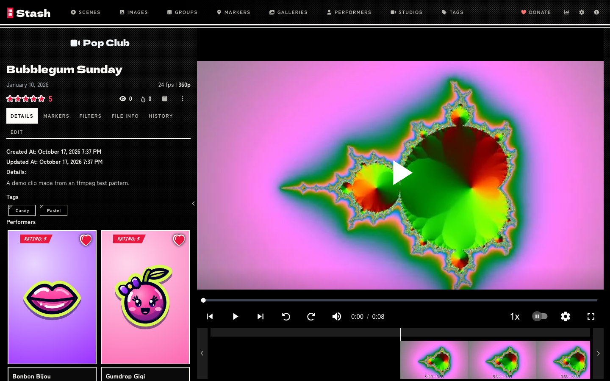
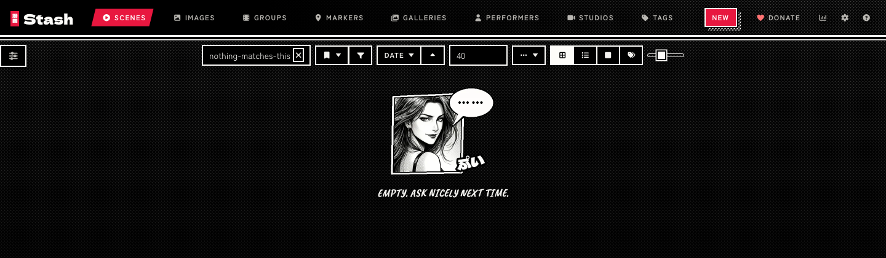
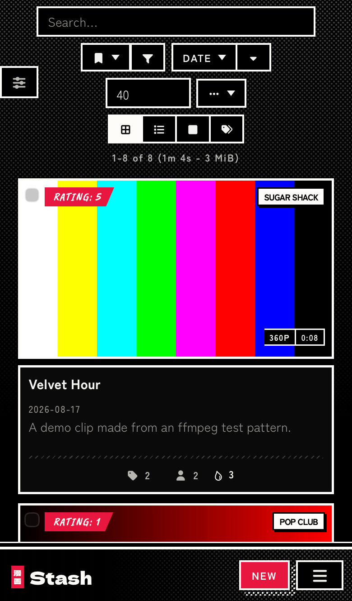

# Screentone

A black-and-white manga theme for [Stash](https://github.com/stashapp/stash), the self-hosted media organizer. Screentone installs as a Stash plugin, so you switch it on, off or update it from Settings > Plugins instead of pasting CSS into the Custom CSS box.

Screentone draws Stash as a page of manga: white ink on solid black, cards as square panels split by black gutters, screentone for shading, speed and focus lines for motion, and one crimson-pink kept for ratings, progress, the favourite and the current page. Ratings are inked stars, the favourite is a heart that jolts with ドキッ, the O counter is the anime sweat drop, toasts and tooltips are speech bubbles, and a short list of Stash's messages speaks in a tsundere's voice. A performer's page opens as a two-panel spread with her name lettered across the gutter. Calm mode and Plain labels settings turn the motion and the copy down, and Stash's SFW mode keeps the ink and drops the voice and the figure. The [live preview](https://candyboudoir.github.io/screentone/) shows every component on Stash's own markup, and the design rules are in [docs/design.md](docs/design.md). Screentone 0.1.0 is built and tested on Stash v0.31.1, including the Tagger and scrape screens that a stash-box such as StashDB adds.

## Install

Screentone comes from the CandyBoudoir plugin source, which carries every CandyBoudoir plugin.

1. In Stash, open Settings > Plugins > Available Plugins and click Add source.
2. Fill in the source:
   - Name: `CandyBoudoir`
   - Source URL: `https://candyboudoir.github.io/index.yml`
   - Local path: `candyboudoir`
3. Expand the CandyBoudoir source, tick Theme - Screentone and click Install.
4. Turn off any other theme plugin, Juicy and Leather included, and clear any Custom CSS that restyles Stash, then refresh the page.

If you run a Stash develop build, use `https://candyboudoir.github.io/develop/index.yml` as the source URL instead. It carries fixes for upcoming Stash changes before they reach the stable channel, and plugins that have no stable release yet. Add one of the two sources, never both: they carry the same plugins.

Stash lists new versions under Settings > Plugins > Installed Plugins when you click Check for updates. To remove Screentone, select it there and click Uninstall; Stash's own look returns on the next refresh.

## Settings

Screentone's settings sit with the plugin under Settings > Plugins. Both start off.

| Setting      | Effect                                                                                                    |
| ------------ | --------------------------------------------------------------------------------------------------------- |
| Calm mode    | Turns off the speed and focus lines on cards, the sparkle bursts, the pounding heart and the loader spin. |
| Plain labels | Keeps Stash's own wording instead of Screentone's tsundere lines.                                         |

Screentone also follows your system's reduced-motion setting. In Stash's SFW content mode it keeps the panels, the tone and the stars, drops the voice and the SFX on cards, toasts and the favourite, and shows an empty list as a silent speech bubble without the figure.

Stash's own Interface setting Enable background image still works: with it on, a performer's blurred picture shows through the gutters of her page, printed in grey under a tone.

Screentone makes no network requests beyond your own Stash server. Its fonts, Dela Gothic One, Caveat Brush and Zen Kaku Gothic New, ship inside the plugin; Dela Gothic One's Japanese is a 2 KB subset holding only the characters the SFX letter. The plugin is about 230 KB, most of it the fonts, and your browser downloads only the font files a page uses.

## Screenshots

| Performer                                                                         | The Tagger                                       |
| --------------------------------------------------------------------------------- | ------------------------------------------------ |
|  |  |
| **A scene**                                                                       | **An empty list**                                |
|                        |      |

The demo library uses invented names and clips made from ffmpeg test patterns, with candy stickers and soft colour stand-ins for its pictures.

## Made with AI

Screentone was built with Claude, Anthropic's AI coding assistant, which wrote most of the CSS, JavaScript and SVG lettering under the author's direction. The two manga figures on the design-system page, and the crop of one of them in the empty-list panel the plugin ships, were rendered locally with Qwen-Image 2512 (Apache 2.0) and cropped with `tools/hero.py`. The author set the design and reviews the changes before each release. Commits that Claude helped write carry a `Co-Authored-By: Claude` line.

## Development

The repo's [README](../../README.md) covers building, testing and releasing. Screentone's files:

- `src/Theme-Screentone.yml` is the plugin manifest.
- `src/css/` holds numbered partials that the build joins into one `screentone.css`.
- `src/js/screentone.js` adds the sparkle bursts, the tsundere copy and the settings.
- `src/icons/` holds the glyph masks, the line overlays, the menu frame and the empty-list panel.
- `src/fonts/` holds the Dela Gothic One subset for the SFX, with its license. The Latin fonts come from fontsource packages at build time.
- `design-system/` is the design-system page, published at `/screentone/`. It loads the built theme over Bootstrap 4.6, which stands in for Stash's own styles, and keeps the hero figures and motif sheets the plugin does not ship.
- `tools/` holds the scripts that draw the icons and lettering, crop the figures and cut the font subset.
- `tests/` holds Screentone's compatibility checks and screenshot baselines.
- `plugin.mjs` tells the shared build what goes into the plugin folder.

## License

MIT, in the repo's [LICENSE](../../LICENSE). Dela Gothic One, Caveat Brush and Zen Kaku Gothic New are bundled under the SIL Open Font License 1.1 (`assets/fonts/dela-gothic-one/OFL.txt`, `assets/fonts/caveat-brush/OFL.txt` and `assets/fonts/zen-kaku-gothic-new/OFL.txt` in the plugin).
